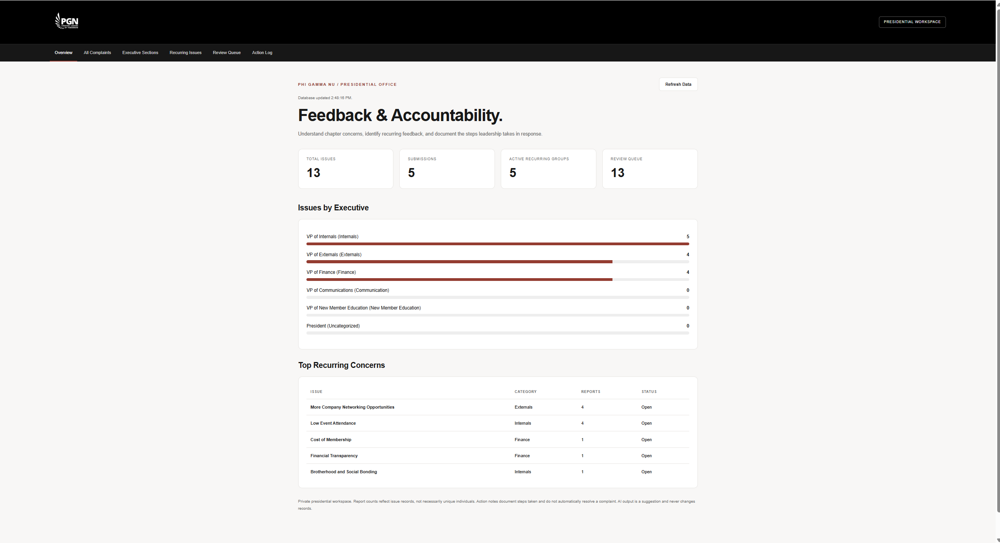

# PGN Feedback & Accountability Hub

**An AI-powered feedback management and leadership accountability platform for Phi Gamma Nu.**

Built using Google Apps Script, Google Forms, Google Sheets, Google Gemini AI, HTML, CSS, and JavaScript.

The PGN Feedback & Accountability Hub is designed to help fraternity leadership collect anonymous feedback, identify recurring concerns, assign issues to the appropriate executive officers, and document the actions taken to address member feedback.

Rather than allowing feedback to disappear after submission, the system provides a centralized presidential workspace for tracking concerns, reviewing trends, and maintaining accountability throughout the semester.

## Dashboard Preview



*Presidential dashboard displaying issue statistics, executive classifications, and recurring concerns using demonstration data.*

The dashboard includes an overview of submitted feedback, executive responsibility breakdowns, recurring concern tracking, a review queue, and a presidential action log.

## Key Features

### 1. AI-Powered Feedback Classification

Google Gemini automatically analyzes feedback submitted through Google Forms.

The system can:

- Extract multiple distinct concerns from a single submission
- Categorize complaints by executive responsibility
- Generate concise, neutral issue summaries
- Preserve the original feedback for verification
- Recommend recurring issue groupings
- Flag uncertain or unsuccessful classifications for review

**Supported executive categories:**

| Category | Responsible Officer |
|---|---|
| Externals | VP of Externals |
| Internals | VP of Internals |
| Finance | VP of Finance |
| Communication | VP of Communications |
| New Member Education | VP of New Member Education |
| Uncategorized | President |

### 2. Presidential Dashboard

A centralized web application provides access to the feedback database without requiring the president to manually navigate Google Sheets.

Dashboard sections include:

- **Overview:** Feedback totals, submissions, executive breakdowns, and recurring concerns
- **All Complaints:** Searchable and filterable complaint records
- **Executive Sections:** Complaints organized by responsible executive
- **Recurring Issues:** Grouped concerns and report counts
- **Review Queue:** Issues requiring leadership attention
- **Action Log:** Documented actions taken by leadership

Each complaint can be opened individually for detailed review and management.

### 3. Recurring Issue Detection

The application identifies complaints involving similar concerns and organizes them into recurring groups.

Examples include:

- More company networking opportunities
- Low event attendance
- Brotherhood and social bonding
- Financial transparency
- Cost of membership
- Late event announcements

Recurring groups maintain information about report counts, dates, priority, status, and associated complaints.

Leadership can manually assign complaints to groups, manage group priorities, and merge overlapping groups.

### 4. Presidential Action Log

The Action Log allows leadership to document its response to complaints and recurring concerns.

Each action includes:

- A unique action identifier
- The associated complaint or recurring issue
- A timestamp
- A description of the action taken

Action notes can be deleted and restored. Deleted notes remain in the private database for recovery and are excluded from AI-generated leadership briefs.

### 5. Human-in-the-Loop AI Correction

The president can correct incorrectly classified complaints.

Corrections are stored in the **Classification Corrections** spreadsheet and used as relevant examples in future Gemini classification prompts.

This allows the application's classifications to benefit from leadership feedback without requiring model retraining or fine-tuning.

### 6. AI Leadership Briefs

For recurring concerns, the president can generate an AI-assisted leadership brief based on existing complaint records and active action notes.

Briefs contain:

- A summary of the recurring concern
- Actions documented by leadership
- Information that remains uncertain
- A suggested next step

AI-generated briefs are read-only recommendations. They do not automatically modify complaints, statuses, or action records.

### 7. Security and Data Protection

The application includes multiple security controls:

- Server-side authorization for dashboard operations
- Restricted Google Apps Script deployment access
- Gemini API credentials stored in Script Properties
- Input validation for management operations
- Spreadsheet formula-injection protections
- Locked processing for concurrent spreadsheet updates
- Gemini usage limits and retry handling
- Preservation of original feedback when AI processing fails

**The production dashboard is currently intended for owner-only access.** Multi-user authentication and officer-specific action attribution are planned future improvements, not features of this version.

## System Architecture

```text
                   GOOGLE FORMS
                        |
                        v
                  GOOGLE SHEETS
                  Form Responses
                        |
                        v
               GOOGLE APPS SCRIPT
                  Form Trigger
                        |
                        v
                   GEMINI AI
               Feedback Analysis
                        |
             +----------+----------+
             |                     |
             v                     v
       Categorized Issues     Recurring Issues
             |                     |
             +----------+----------+
                        |
                        v
                PRESIDENTIAL DASHBOARD
                        |
          +-------------+-------------+
          |             |             |
          v             v             v
     Complaint      Action Log     AI Leadership
     Management                     Briefs
```

## Technology Stack

| Technology | Purpose |
|---|---|
| Google Forms | Feedback collection |
| Google Sheets | Data storage |
| Google Apps Script | Backend logic, automation, and web application |
| Google Gemini API | AI classification and leadership briefs |
| HTML5 | Dashboard structure |
| CSS3 | Responsive dashboard interface |
| JavaScript | Frontend interaction and backend logic |
| Node.js | Local automated testing |
| GitHub | Version control and documentation |

## Repository Structure

```text
PGN-Feedback-Accountability-Hub/
|
|-- Code.gs
|-- Index.html
|-- README.md
|-- SETUP.md
|-- SECURITY_PRIVACY.md
|-- AUDIT_REPORT.md
|-- TEST_RESULTS.md
|-- TEST_PLAN.md
|-- IMPROVEMENTS.md
|-- CLAUDE_MASTER_AUDIT.md
|-- .gitignore
|
|-- assets/
|   |-- pgn-dashboard.png
|
|-- tests/
|   |-- run-tests.js
|   |-- apps-script-mocks.js
|   |-- synthetic-dataset.json
|   |-- build-preview.js
|   |-- serve.js
```

## Installation and Setup

The application can be recreated under a different Google account using this repository.

### Prerequisites

- Google account
- Google Form linked to a Google Sheets spreadsheet
- Google Apps Script access
- Gemini API key
- Permission to deploy Google Apps Script web applications

### Step 1: Download the Repository

Clone the repository:

```bash
git clone https://github.com/RithvikD10/PGN-Feedback-Accountability-Hub.git
```

Alternatively, select **Code → Download ZIP** on GitHub.

### Step 2: Create the Feedback Form

Create a Google Form containing these questions:

1. **What type of feedback are you submitting?**
2. **What would you like PGN to know?**

Connect the Form to Google Sheets.

The default configuration expects the response worksheet to be named `Form Responses 1`.

### Step 3: Create the Apps Script Project

From the linked Google Sheets spreadsheet:

1. Open **Extensions → Apps Script**
2. Replace the contents of `Code.gs` with the repository's audited backend
3. Create an HTML file named `Index`
4. Paste the contents of `Index.html`
5. Save the project

### Step 4: Configure Gemini

Open **Project Settings → Script Properties**.

Add:

```text
Property: GEMINI_API_KEY
Value: YOUR_GEMINI_API_KEY
```

Never hardcode API keys in source files or upload credentials to GitHub.

### Step 5: Initialize the Database

In the Apps Script editor, run:

```javascript
pgnSetupProject()
```

This initializes the managed spreadsheet structure.

Then run:

```javascript
pgnInstallFormTrigger()
```

This installs the spreadsheet form-submission trigger if one is not already installed.

### Step 6: Verify the Application

Run:

```javascript
testPGNAuthorization()
testStructuredGemini()
testPGNFinalSetup()
```

Confirm that the authorization check passes and Gemini successfully processes fictional feedback.

### Step 7: Deploy the Dashboard

Deploy the application as a Google Apps Script web app.

For the owner-only deployment:

```text
Execute as: Me
Who has access: Only myself
```

Open the generated `/exec` URL to access the dashboard.

For detailed instructions, troubleshooting, and recovery procedures, see [SETUP.md](SETUP.md).

## Testing and Verification

The application underwent a code audit and local automated testing.

**Automated testing:** 41 synthetic scenarios passed using a mocked Google Apps Script environment.

Live checks completed on October 11, 2026 included:

- Spreadsheet initialization and trigger detection
- Authorization verification for the owner account
- Successful Gemini classification of three distinct concerns
- Dashboard loading and navigation
- Complaint status management
- Presidential Action Log functionality
- Deployment of the audited application

The application's cross-account authorization was also tested. The existing implementation did not reliably authenticate a second Gmail account, so multi-user login has been deferred until a dedicated authentication system is implemented.

These checks do not constitute an independent security certification or guarantee of production reliability.

Run the local test suite with:

```bash
node tests/run-tests.js
```

Additional details are available in [TEST_RESULTS.md](TEST_RESULTS.md) and [TEST_PLAN.md](TEST_PLAN.md).

## Data Privacy

This project handles potentially sensitive fraternity feedback.

The public GitHub repository contains application source code and synthetic testing material. It is not intended to contain real submissions, private spreadsheet records, API keys, or deployed application credentials.

Although the feedback form can be configured not to collect identifying information, anonymity cannot be guaranteed solely through application code. Submission timestamps, writing style, and details volunteered by respondents may allow identification.

Feedback sent to Gemini is processed by an external AI service. Deploying organizations should review the applicable Google API data-use terms and communicate the processing practices to members.

See [SECURITY_PRIVACY.md](SECURITY_PRIVACY.md).

## Future Development

Potential improvements include:

- Google Sign-In for approved officers
- Administrator-managed user access
- Officer-specific action attribution
- Comprehensive activity audit trails
- Role-based permissions
- Historical trend analysis
- Semester-based reporting
- Automated leadership summaries
- Expanded recurring-issue detection
- Exportable leadership reports

The current version prioritizes reliable feedback collection, classification, recurring issue tracking, and presidential management.

For the detailed roadmap, see [IMPROVEMENTS.md](IMPROVEMENTS.md).

## Documentation

| Document | Description |
|---|---|
| [SETUP.md](SETUP.md) | Installation and deployment instructions |
| [SECURITY_PRIVACY.md](SECURITY_PRIVACY.md) | Security design, privacy considerations, and limitations |
| [AUDIT_REPORT.md](AUDIT_REPORT.md) | Findings from the code audit |
| [TEST_RESULTS.md](TEST_RESULTS.md) | Automated and live test results |
| [TEST_PLAN.md](TEST_PLAN.md) | Testing procedures and scenarios |
| [IMPROVEMENTS.md](IMPROVEMENTS.md) | Future features and development plans |
| [CLAUDE_MASTER_AUDIT.md](CLAUDE_MASTER_AUDIT.md) | Original audit requirements |

## Project Status

**Version:** 1.0.0

**Status:** Deployed and internally tested

**Initial audited release:** October 11, 2026

**Deployment:** Private Google Apps Script web application

**Repository:** Public source code and technical documentation

## Project Purpose

The PGN Feedback & Accountability Hub was developed to improve how Phi Gamma Nu collects, understands, and responds to member feedback.

The goal is to provide a repeatable system that future fraternity leadership can maintain, improve, and deploy under an authorized organizational account.

By combining AI-assisted classification with human review and documented leadership actions, the platform aims to strengthen communication, transparency, and accountability within the chapter.

---

Developed for **Phi Gamma Nu at Virginia Tech**.

*This repository contains the application implementation and documentation, not the fraternity's private feedback database.*
